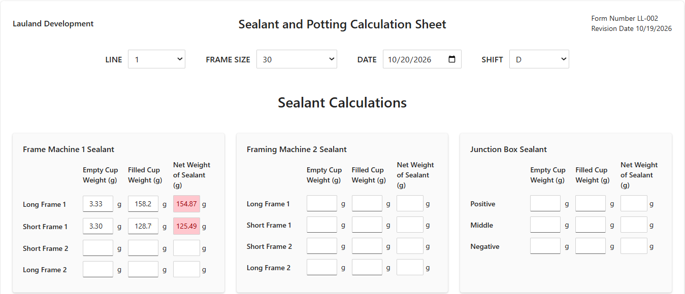
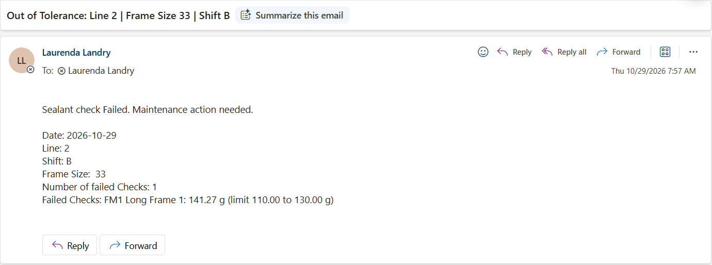

# Sealant Weight Check & Maintenance Alerts

Out-of-spec sealant weights reach maintenance in about a minute, with zero hand math.

**Built with:** Power Apps (model-driven, generative page) · Dataverse · Power Automate · Outlook connector

▶️ **[Watch the demo](https://youtu.be/uuLP_Nw_FGA)** (70 seconds)

---

## The problem

Sealant and potting checks mean weighing about 20 cups, working out each net weight by hand, and comparing every result to limits that change by frame size. Even when someone catches a bad number, the next step is tracking down maintenance to fix it.

## What I built

**1. A Power App that does the math and the checking**
- Net weights and potting ratios calculate as you type.
- Limits load from a tolerance table based on the frame size you pick.
- Anything out of tolerance turns red. Passing values stay plain, so problems stand out.
- On submit, the app saves the full check as one Dataverse record, plus a count and summary of failed checks.

**2. A Power Automate flow that alerts maintenance**
- Triggers when a new row is added to Sealant Logs.
- A filter on the trigger (`craf4_outoftolerancecount gt 0`) means only failed checks start a run. Passing checks never wake the flow up.
- Emails maintenance the line, shift, frame size, and each failed check with its value and limit.

## Design decisions

- **Tolerances live in a table, not in code.** Change a limit in Sealant Tolerances and the app follows it. No republishing.
- **The app flags failures, the flow routes them.** The app already knows which values are red, so it saves that with the record. That keeps the flow to one trigger, one filter, and one action instead of 20 condition branches.
- **New rows only.** The trigger fires on Added, not Modified, so editing a record never sends a repeat alert.
- **Failures are never overwritten.** A re-test is a new record with only the re-checked rows filled in. The original failure stays in the log as history.

## Data model

| Table | Purpose |
|---|---|
| Sealant Logs | One row per check: line, shift, frame size, date, every empty cup, filled cup, and net weight, potting ratios, out-of-tolerance count, and details |
| Sealant Tolerances | One row per check type: frame size, min, and max. Frame Size 0 means the limit applies to every frame size. |

## What's in this repo

| File | What it is |
|---|---|
| `SealantWeightCheck_1_0_0_0.zip` | Unmanaged Power Platform solution: both tables, the model-driven app, and the cloud flow |
| `sample_tolerances.csv` | Sample tolerance values to load into Sealant Tolerances |
| `screenshots/` | App, flow, and alert email |

## Run it yourself

1. In a Power Platform environment with Dataverse, go to **Solutions**, then **Import solution**, and pick the .zip.
2. When prompted, set up the **Dataverse** and **Office 365 Outlook** connections.
3. Import `sample_tolerances.csv` into the Sealant Tolerances table.
4. Open the flow and change the **To** address to your own email. Turn the flow on.
5. Play the app, enter a value outside the limits, and submit.

Tolerances shown are sample values.

## What I'd add next

- A **Re-test** flag so re-check records are labeled, and a "back in spec" message to close the loop.
- A **Reason** field (Routine, Re-test, Restart after downtime) for full re-checks.
- Posting alerts to a Teams channel for maintenance instead of email.

---

**Laurenda Landry** · [lauland.dev](https://lauland.dev) · [LinkedIn](https://linkedin.com/in/lauland)
